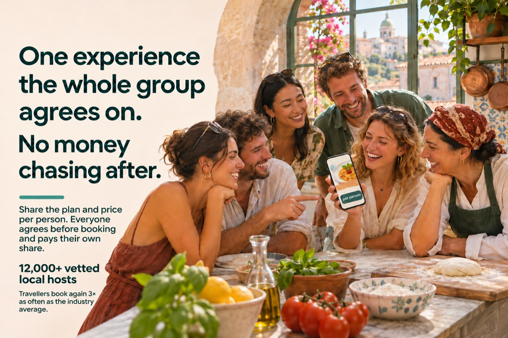

# Messaging Pillars · Roamly Groups

## 1. From/To market shift

- **From, life before:** Friends and families want to share an experience, but choosing one everyone likes takes coordination. They often book through a product built around one person’s decision, and that person may end up paying upfront and chasing everyone else.
- **To, life after:** A group can agree on an experience and its price before booking. Everyone sees the same plan, has a say, and pays their own share, so the organiser can bring the group together without carrying the decision or the bill alone.

## 2. Audiences

- **Number of audiences that need their own message:** 2
- **Why you picked this number:** The organiser brings the group together and carries the coordination. The other friends or family members need to feel included in the choice and confident about their own price and payment. The same experience serves both, but each audience has a different reason to care.

## 3. Messaging pillars

### Audience 1: The organiser bringing friends or family together to plan an experience in one of Roamly’s 40 cities.
- **Value prop:** Get the group from “let’s do something” to a booked experience everyone has agreed on, without having to make the choice alone or chase people for money.
- **Capabilities:** Share the plan and price per person in one place, let everyone agree before booking, and have each person pay their own share.
- **Evidence:** Roamly works with 12,000+ vetted local hosts. Their travellers book again at three times the industry average. To prove in beta: group booking completion rate.

### Audience 2: Friends and family members invited to join a shared experience.
- **Value prop:** Have a say in what the group does, know what it will cost you, and join without someone else having to cover your share upfront.
- **Capabilities:** See the shared plan and your price, agree in the same place as the rest of the group, and pay your own share.
- **Evidence:** The experience is delivered by one of Roamly’s 12,000+ vetted local hosts. Travellers book with Roamly hosts again at three times the industry average. To prove in beta: the share of invitees who pay their own share in time.

## 4. Copy across three surfaces

- **Surface 1:** Homepage headline: "One experience the whole group agrees on. No money chasing after." Leads with the value prop: connects the shared decision directly to the organiser’s relief.
- **Surface 2:** Email subject line: "Can everyone agree on the plan before you book?" Leads with the value prop: names the organiser’s immediate challenge and frames the email around resolving it.
- **Surface 3:** Onboarding tooltip: "Invite everyone to review the plan and their price. You won’t need to cover the group’s bill yourself." Leads with the value prop: reassures the organiser about the outcome while tying it to the group’s individual prices.

## 5. Visual asset

